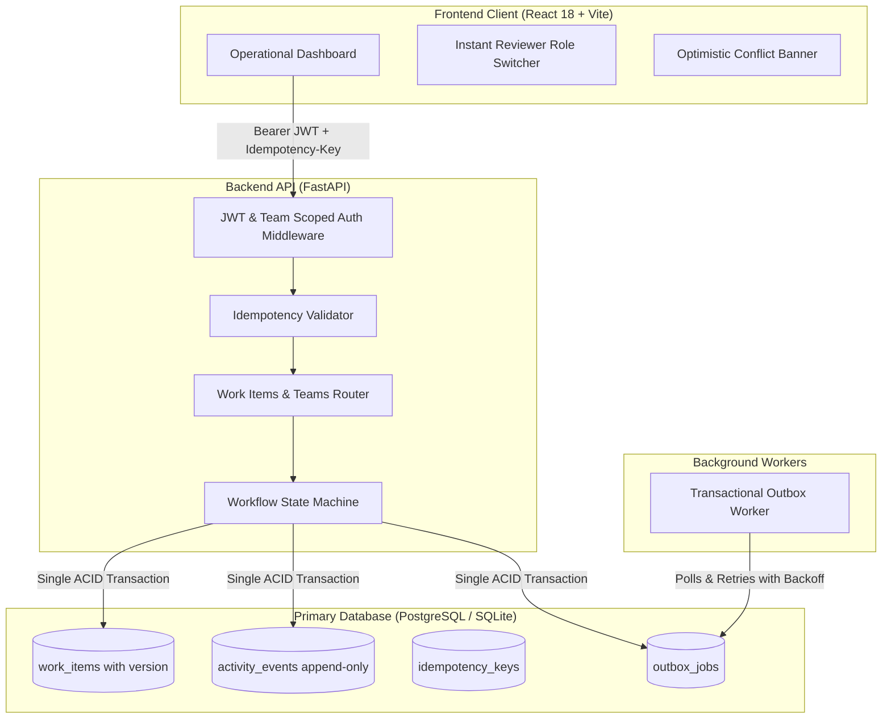

# Newtonite Ops — Operations Under Pressure

[](file:///e:/Antigravity_workspace/Newtonite_project/backend/tests)
[](https://www.python.org/)
[](https://fastapi.tiangolo.com/)
[](https://react.dev/)

An enterprise internal operational work-item management platform engineered for high-concurrency environments. It allows teams to create, assign, track, and resolve operational incidents and tasks with strict server-enforced workflow state machines, atomic race-condition protections, optimistic locking, idempotent request handling, and append-only transactional audit logs.

---

## 🏛️ System Architecture



---

## ⚡ Prerequisites & Quick Start

You can run the application with **Docker Compose (one-command setup)** or locally with **Python + Node.js**.

### Option A: Running with Docker Compose (Recommended for Evaluators)

1. Clone and enter the repository:
   ```bash
   git clone <repo-url>
   cd newtonite-ops
   ```
2. Launch the full stack (PostgreSQL + FastAPI + React frontend + Outbox worker):
   ```bash
   docker compose up --build
   ```
3. Open your browser:
   * **Frontend Application:** [http://localhost:3000](http://localhost:3000)
   * **Interactive API Swagger Docs:** [http://localhost:8000/docs](http://localhost:8000/docs)
   * **API Health Check:** [http://localhost:8000/api/health](http://localhost:8000/api/health)

---

### Option B: Running Locally (Windows / macOS / Linux)

#### 1. Backend Setup
```bash
cd backend
python -m venv venv

# Windows:
venv\Scripts\activate
# Linux/macOS:
# source venv/bin/activate

pip install -r requirements.txt

# Seed 4 teams, 11 demo users, and 2,500 scale records:
python -m seed.seed_data

# Start FastAPI server:
uvicorn app.main:app --host 0.0.0.0 --port 8000 --reload
```

#### 2. Frontend Setup
In a new terminal:
```bash
cd frontend
npm install
npm run dev
```
Open [http://localhost:3000](http://localhost:3000).

---

## 🔑 Demo Login Credentials per Role

The database is pre-seeded with multiple users across distinct roles and teams. Use the **Reviewer Role Switcher** dropdown in the top navigation bar to instantaneously switch identities:

| Name | Email | Password | Team & Role | Permissions |
| :--- | :--- | :--- | :--- | :--- |
| **Alice Morgan** | `alice@newtonite.io` | `password123` | **Platform Engineering (Lead)**, Payments (Member) | Full lead rights: can claim, transition, and **approve** items to `Resolved` |
| **Bob Chen** | `bob@newtonite.io` | `password123` | **Platform Engineering (Member)**, Customer Ops (Lead) | Standard member: can work and request approval, but **cannot approve** on Platform |
| **Charlie Davis** | `charlie@newtonite.io` | `password123` | **Platform Engineering (Viewer)** | Read-only audit access: cannot claim, edit, or transition items |
| **Diana Prince** | `diana@newtonite.io` | `password123` | **All Teams (Admin)** | Superuser administration privileges |
| **Outsider Owen**| `owen@external.io` | `password123` | **No Memberships (External)** | Unaffiliated user: receives **HTTP 403 Forbidden** on team items |

---

## 🧪 How to Run Automated Tests

Run the complete behavioral test suite with a single command from the project root:

```bash
# Windows (One-command runner):
.\run_tests.bat

# Linux / macOS (One-command runner):
./run_tests.sh

# Or directly using the backend venv:
cd backend
venv\Scripts\pytest -v      # Windows
# pytest -v                 # Linux / macOS
```

### Verified Test Cases:
1. `tests/test_concurrency.py`: Fires two parallel claims on the same unassigned item via `asyncio.gather`. Exactly one succeeds (200 OK), and the second receives a **409 Conflict**.
2. `tests/test_optimistic_locking.py`: Stale version updates are rejected with **409 Conflict** and the current state is returned without data corruption.
3. `tests/test_idempotency.py`: Replaying requests with the same `Idempotency-Key` header prevents duplicate creation and returns the cached response in a single atomic transaction. Replaying with tampered payload triggers **422 Unprocessable Entity**.
4. `tests/test_workflow.py`: Enforces state transitions. Invalid jumps (e.g. `Open` $\rightarrow$ `Closed`) return **400 Bad Request**. Approval to `Resolved` attempted by a non-Lead is rejected with **403 Forbidden**, but succeeds when attempted by a `Lead`.
5. `tests/test_authorization.py`: Multi-tenant isolation. External users get **403 Forbidden** on reads, writes, and team member listings; `Viewer` roles are blocked from modifying items.
6. `tests/test_outbox.py`: Verifies the Transactional Outbox pattern commits events in the same ACID transaction, the background worker processes retries with exponential backoff, caps at `max_attempts`, and validates idempotent handler execution.

---

## 🛡️ Critical Engineering Decisions

For detailed context, architectural options considered, chosen solutions, and trade-offs, read [ENGINEERING_DECISIONS.md](file:///e:/Antigravity_workspace/Newtonite_project/ENGINEERING_DECISIONS.md).

Key Highlights:
1. **Atomic Conditional Claiming:** `UPDATE ... WHERE id = :id AND assignee_id IS NULL;` prevents race conditions without table-level blocking.
2. **Optimistic Locking:** Monotonic version counter protects concurrent edits from silent overwrites.
3. **Transactional Outbox:** Guaranteed At-Least-Once downstream notification dispatch without dual-write failure modes.
4. **Server-Side Cursor Pagination:** Efficient index-driven pagination (`WHERE id < :cursor LIMIT 25`) capable of scaling to millions of rows.

---

## ⚠️ Known Limitations & "Next Week I Would..."

### Known Limitations
* **WebSockets / Push Notifications:** Currently relies on on-action refetching and polling.
* **Cold Storage Archival:** Activity logs grow indefinitely and will require monthly table partitioning at $>10\times$ volume.

### Next Week I Would...
1. **Database Partitioning:** Range-partition `activity_events` and `outbox_jobs` tables by calendar month to sustain hundreds of millions of audit entries.
2. **SSE (Server-Sent Events) Stream:** Add an SSE feed for live outbox events so teammates see colleagues claim items in real-time without polling.
3. **Dead Letter Queue UI:** A dedicated operations portal view allowing Lead engineers to inspect and manually retry jobs that exceeded `max_attempts`.
